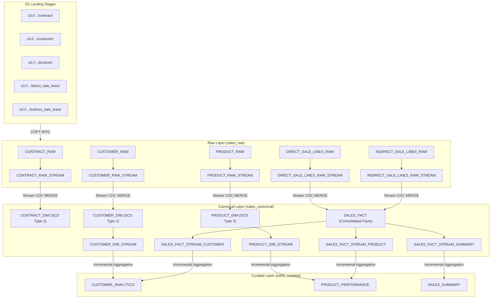

# SF_DRL: Snowflake Native Data Pipeline

A 100% **Snowflake Native** end-to-end data ingestion, transformation, and orchestration pipeline. This project replaces external transformation frameworks (such as dbt) entirely with Snowflake-native architectural primitives: **Snowflake Views**, **Native SQL MERGE statements**, and **Change Data Capture (CDC) Streams**.

Transformations are organized under the [`transform/`](file:///c:/repos/SF_DRL/transform) directory, exactly mirroring the structure and submodules of the [`schema/`](file:///c:/repos/SF_DRL/schema) directory.

---

## Architecture Overview



---

## Structural Alignment: `schema/` and `transform/`

The project maintains an exact 1:1 alignment between table DDL schemas and transformation SQL files across stages and submodules:

| Layer / Stage | Submodule | Schema Definition (DDL) | Transformation SQL (Single Source of Truth) | Target Snowflake Object |
| :--- | :--- | :--- | :--- | :--- |
| **Raw** | `domaindata` | `schema/raw/domaindata/contract_raw.yaml` | `transform/raw/domaindata/streams.sql` | `sales_raw.CONTRACT_RAW` & CDC Stream |
| | `masterdata` | `schema/raw/masterdata/customer_raw.yaml` | `transform/raw/masterdata/streams.sql` | `sales_raw.CUSTOMER_RAW` & CDC Stream |
| | `masterdata` | `schema/raw/masterdata/product_raw.yaml` | `transform/raw/masterdata/streams.sql` | `sales_raw.PRODUCT_RAW` & CDC Stream |
| | `sales` | `schema/raw/sales/direct_sale_lines_raw.yaml` | `transform/raw/sales/streams.sql` | `sales_raw.DIRECT_SALE_LINES_RAW` & CDC Stream |
| | `sales` | `schema/raw/sales/indirect_sale_lines_raw.yaml` | `transform/raw/sales/streams.sql` | `sales_raw.INDIRECT_SALE_LINES_RAW` & CDC Stream |
| **Canonical** | `domaindata` | `schema/canonical/domaindata/contract.yaml` | `transform/canonical/domaindata/contract_dim.sql` | `sales_canonical.CONTRACT_DIM` |
| | `masterdata` | `schema/canonical/masterdata/customer_dim.yaml` | `transform/canonical/masterdata/customer_dim.sql`<br>`transform/canonical/masterdata/streams.sql` | `sales_canonical.CUSTOMER_DIM` & CDC Stream |
| | `masterdata` | `schema/canonical/masterdata/product_dim.yaml` | `transform/canonical/masterdata/product_dim.sql`<br>`transform/canonical/masterdata/streams.sql` | `sales_canonical.PRODUCT_DIM` & CDC Stream |
| | `sales` | `schema/canonical/sales/sales_fact.yaml` | `transform/canonical/sales/sales_fact.sql`<br>`transform/canonical/sales/streams.sql`<br>`transform/canonical/sales/sales_fact_direct.sql`<br>`transform/canonical/sales/sales_fact_indirect.sql` | `sales_canonical.SALES_FACT`<br>CDC Streams & Projections: `SALES_FACT_DIRECT`, `SALES_FACT_INDIRECT` |
| **Curated** | *(root)* | `schema/curated/customer_analytics.yaml` | `transform/curated/customer_analytics.sql` | `sales_curated.CUSTOMER_ANALYTICS` |
| | *(root)* | `schema/curated/product_performance.yaml` | `transform/curated/product_performance.sql` | `sales_curated.PRODUCT_PERFORMANCE` |
| | *(root)* | `schema/curated/sales_summary.yaml` | `transform/curated/sales_summary.sql` | `sales_curated.SALES_SUMMARY` |

---

## Directory Tree

```
SF_DRL/
├── README.md                           # Complete architecture guide & command reference
├── .env.example                        # Template for Snowflake credentials & environment variables
├── schema/                             # YAML Table Schemas (DDL source of truth)
│   ├── raw/                            # Raw layer schemas
│   │   ├── domaindata/                 # contract_raw.yaml
│   │   ├── masterdata/                 # customer_raw.yaml, product_raw.yaml
│   │   └── sales/                      # direct_sale_lines_raw.yaml, indirect_sale_lines_raw.yaml
│   ├── canonical/                      # Canonical layer schemas
│   │   ├── domaindata/                 # contract.yaml
│   │   ├── masterdata/                 # customer_dim.yaml, product_dim.yaml
│   │   └── sales/                      # sales_fact.yaml
│   └── curated/                        # Curated analytical schemas
│       ├── customer_analytics.yaml
│       ├── product_performance.yaml
│       └── sales_summary.yaml
├── transform/                          # Snowflake Native Transformation SQL Scripts
│   ├── raw/                            # Raw layer views and CDC streams
│   │   ├── domaindata/                 # streams.sql
│   │   ├── masterdata/                 # streams.sql
│   │   └── sales/                      # streams.sql
│   ├── canonical/                      # Canonical layer transformations & CDC streams
│   │   ├── domaindata/                 # contract_dim.sql
│   │   ├── masterdata/                 # customer_dim.sql, product_dim.sql, streams.sql
│   │   └── sales/                      # sales_fact.sql, streams.sql, sales_fact_direct.sql, sales_fact_indirect.sql
│   └── curated/                        # Curated layer aggregations
│       ├── customer_analytics.sql
│       ├── product_performance.sql
│       └── sales_summary.sql
├── scripts/
│   ├── schema_orchestrator.py          # Complete environment orchestrator
│   ├── snowflake_transforms.py         # Direct Native Transformation Engine & View Deployer
│   ├── copy_and_load.py                # Unified Copy Load + Direct Native Transformation Pipeline
│   ├── copy_data.py                    # Stage & Raw copy load logic
│   ├── ddl_generator.py                # YAML to DDL SQL generator
│   ├── snowflake_utils.py              # Snowflake connector & query helpers (reads .env)
│   └── copy_data_manifest.json         # S3 landing to raw table mappings
└── templates/                          # Configuration templates: file_formats.csv, stages.csv, stream_mappings.csv, module_dependencies.csv, deploy_manifest.csv
```

---

## Zero-Configuration Model Auto-Discovery

The transformation orchestrator (`scripts/snowflake_transforms.py`) dynamically discovers models directly from the filesystem hierarchy under `transform/`:

- **Stage & Schema Layer:** Decoded automatically from the directory (`transform/canonical/...` → `sales_canonical`, `transform/curated/...` → `sales_curated`).
- **Target Table Name:** Decoded from the SQL file stem (e.g. `contract_dim.sql` → `CONTRACT_DIM`).
- **Referenced CDC Streams:** Automatically parsed from the SQL query text by matching against `templates/stream_mappings.csv`.
- **Execution Order:** Resolved from a dependency graph (see below), not from file names.
- **Full Refresh Handling:** Automatically swaps stream references to base tables and resets stream offsets post-load.

> **Adding a New Model:** Simply create your `.sql` file under `transform/canonical/` or `transform/curated/`. No Python code edits or model registration CSVs required.

---

## Model & Module Dependencies

Execution order is a topological sort that combines three sources:

| Source | Defined in | Example |
| :--- | :--- | :--- |
| **SQL lineage** (automatic) | The model SQL itself: any `{SCHEMA_*}.TABLE` or stream it reads that another model produces | `customer_analytics.sql` reads `CUSTOMER_DIM_STREAM` → depends on `CUSTOMER_DIM` |
| **Module rules** | `templates/module_dependencies.csv` | `curated` depends on `canonical`; `canonical/sales` depends on `canonical/masterdata;canonical/domaindata` |
| **SQL hints** (optional) | A header comment in the model: `-- depends_on: TABLE_A, TABLE_B` | Edge cases lineage can't see |

`templates/module_dependencies.csv`:
```csv
module,depends_on,description
canonical/domaindata,,Contract domain data
canonical/masterdata,,Customer and product master data
canonical/sales,canonical/masterdata;canonical/domaindata,Sales facts load after master and domain data
curated,canonical,Curated analytics depend on the entire canonical layer
```
- `module` is a path relative to `transform/`. A rule applies to that module and all its sub-modules (`curated` covers `curated/finance/...`).
- `depends_on` accepts module paths or whole layers (`canonical`).

Runtime behaviour:
- **Failure isolation:** if a model fails, only its downstream dependents are `BLOCKED`; independent models still run. The run exits non-zero at the end.
- **Cycle detection:** circular dependencies stop the run before any SQL is executed.
- **Stage filtering:** `--stage curated` runs only curated models; canonical upstreams are assumed already loaded (logged).
- **Inspect the plan:** `python scripts/snowflake_transforms.py --show-deps`

---

## Quickstart & Usage

### 1. Deploy the Complete Infrastructure & Native Objects
Runs database creation, schemas, external stages, tables from YAML, staging views, and CDC streams:
```bash
python scripts/schema_orchestrator.py
```
*(To preview without executing: `python scripts/schema_orchestrator.py --dry-run`)*

### 2. Run the Full Ingestion & Transformation Pipeline
Executes `COPY INTO` from S3 into raw tables, then executes canonical and curated transformations directly from the SQL files:
```bash
# Run full pipeline (Raw COPY load + Canonical + Curated):
python scripts/copy_and_load.py

# With full refresh (truncate targets & reload):
python scripts/copy_and_load.py --full-refresh

# Run transformations only (Canonical + Curated):
python scripts/copy_and_load.py --stage transforms

# Ingest raw data only:
python scripts/copy_and_load.py --stage raw
```

### 3. Standalone Transformation Management
```bash
# Deploy/update views and CDC streams in Snowflake:
python scripts/snowflake_transforms.py --deploy

# Execute all transformations directly (incremental):
python scripts/snowflake_transforms.py --stage all

# Execute all transformations with full refresh (truncate & reload):
python scripts/snowflake_transforms.py --stage all --full-refresh

# Execute a specific stage:
python scripts/snowflake_transforms.py --stage canonical
python scripts/snowflake_transforms.py --stage curated
```

---

### 4. Apache Airflow Orchestration & Monitoring (Localhost:8088)

The project includes production Airflow DAGs located in the `dags/` directory:

#### A. Incremental CDC Pipeline (`dags/sf_drl_pipeline_dag.py`)
1. **DAG ID:** `sf_drl_incremental_pipeline`
2. **Schedule:** `0 */6 * * *` (Every 6 hours)
3. **Task Structure:**
   * **Stage 1 (Raw Ingestion):** Individual tasks for S3 ingestion (`copy_contract`, `copy_customer`, `copy_product`, `copy_dir_sale_lines`, `copy_indir_sale_lines`).
   * **Stage 2 (Canonical Transforms):** Tasks for `CONTRACT_DIM`, `CUSTOMER_DIM`, `PRODUCT_DIM`, and `SALES_FACT`.
   * **Stage 3 (Curated Analytics):** Tasks for `CUSTOMER_ANALYTICS`, `PRODUCT_PERFORMANCE`, and `SALES_SUMMARY`.
4. **Trigger with Full Refresh:**
   In the Airflow UI (`http://localhost:8088/`), click **Trigger DAG w/ config** and pass:
   ```json
   {
     "full_refresh": true
   }
   ```
   *(Defaults to `false` for incremental stream CDC processing).*

#### B. Schema & Infrastructure Provisioning (`dags/sf_drl_provision_dag.py`)
1. **DAG ID:** `sf_drl_schema_provisioning`
2. **Schedule:** `None` (strictly on-demand for provisioning / DDL deployments)
3. **Task Structure:**
   * `1_create_database_and_schemas`: Creates `sales` database and schemas (`sales_raw`, `sales_canonical`, `sales_curated`).
   * `2_setup_external_stage_objects`: Creates File Formats, Storage Integrations, and External Stages from `templates/*.csv`.
   * `3_create_target_tables`: Generates and executes `CREATE TABLE IF NOT EXISTS` for all tables defined in `schema/**/*.yaml`.
   * `4_setup_transformation_objects`: Deploys staging views and CDC streams from `transform/` hierarchy.
4. **Trigger Options (via "Trigger DAG w/ config"):**
   * **Live Provisioning:** Default trigger `{}`.
   * **Dry-Run Preview (validates SQL without running DDL):**
     ```json
     {
       "dry_run": true
     }
     ```
   * **Skip Native Transforms:**
     ```json
     {
       "skip_transforms": true
     }
     ```


