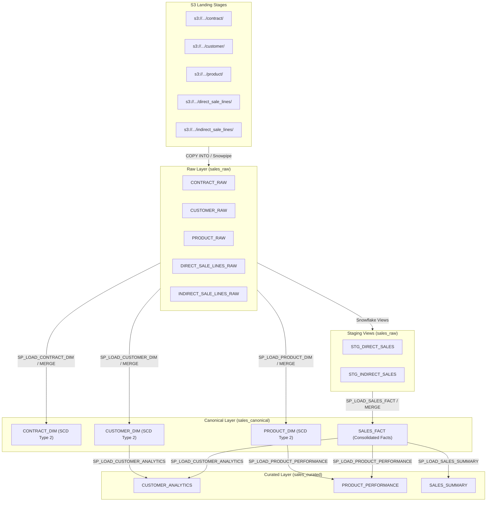

# SF_DRL: Snowflake Native Data Pipeline

A 100% **Snowflake Native** end-to-end data ingestion, transformation, and orchestration pipeline. This project replaces external transformation frameworks (such as dbt) entirely with Snowflake-native architectural primitives: **Snowflake Views**, **Native SQL MERGE statements**, **Stored Procedures**, **Change Data Capture (CDC) Streams**, and **Task DAGs**.

Transformations are organized under the [`transform/`](file:///c:/repos/SF_DRL/transform) directory, exactly mirroring the structure and submodules of the [`schema/`](file:///c:/repos/SF_DRL/schema) directory.

---

## Architecture Overview



---

## Structural Alignment: `schema/` and `transform/`

The project maintains an exact 1:1 alignment between table DDL schemas and transformation SQL files across stages and submodules:

| Layer / Stage | Submodule | Schema Definition (DDL) | Transformation SQL (Logic + Proc) | Target Snowflake Object |
| :--- | :--- | :--- | :--- | :--- |
| **Raw** | `masterdata` | `schema/raw/masterdata/contract_raw.yaml` | `transform/raw/masterdata/streams.sql` | `sales_raw.CONTRACT_RAW` & Stream |
| | `masterdata` | `schema/raw/masterdata/customer_raw.yaml` | `transform/raw/masterdata/streams.sql` | `sales_raw.CUSTOMER_RAW` & Stream |
| | `masterdata` | `schema/raw/masterdata/product_raw.yaml` | `transform/raw/masterdata/streams.sql` | `sales_raw.PRODUCT_RAW` & Stream |
| | `sales` | `schema/raw/sales/direct_sale_lines_raw.yaml` | `transform/raw/sales/stg_direct_sales.sql`<br>`transform/raw/sales/streams.sql` | `sales_raw.DIRECT_SALE_LINES_RAW`<br>`sales_raw.STG_DIRECT_SALES` (View) |
| | `sales` | `schema/raw/sales/indirect_sale_lines_raw.yaml` | `transform/raw/sales/stg_indirect_sales.sql`<br>`transform/raw/sales/streams.sql` | `sales_raw.INDIRECT_SALE_LINES_RAW`<br>`sales_raw.STG_INDIRECT_SALES` (View) |
| **Canonical** | `masterdata` | `schema/canonical/masterdata/contract.yaml` | `transform/canonical/masterdata/contract_dim.sql` | `sales_canonical.CONTRACT_DIM`<br>`SP_LOAD_CONTRACT_DIM()` |
| | `masterdata` | `schema/canonical/masterdata/customer_dim.yaml` | `transform/canonical/masterdata/customer_dim.sql` | `sales_canonical.CUSTOMER_DIM`<br>`SP_LOAD_CUSTOMER_DIM()` |
| | `masterdata` | `schema/canonical/masterdata/product_dim.yaml` | `transform/canonical/masterdata/product_dim.sql` | `sales_canonical.PRODUCT_DIM`<br>`SP_LOAD_PRODUCT_DIM()` |
| | `sales` | `schema/canonical/sales/sales_fact.yaml` | `transform/canonical/sales/sales_fact.sql`<br>`transform/canonical/sales/sales_fact_direct.sql`<br>`transform/canonical/sales/sales_fact_indirect.sql` | `sales_canonical.SALES_FACT`<br>`SP_LOAD_SALES_FACT()`<br>Projections: `SALES_FACT_DIRECT`, `SALES_FACT_INDIRECT` |
| **Curated** | *(root)* | `schema/curated/customer_analytics.yaml` | `transform/curated/customer_analytics.sql` | `sales_curated.CUSTOMER_ANALYTICS`<br>`SP_LOAD_CUSTOMER_ANALYTICS()` |
| | *(root)* | `schema/curated/product_performance.yaml` | `transform/curated/product_performance.sql` | `sales_curated.PRODUCT_PERFORMANCE`<br>`SP_LOAD_PRODUCT_PERFORMANCE()` |
| | *(root)* | `schema/curated/sales_summary.yaml` | `transform/curated/sales_summary.sql` | `sales_curated.SALES_SUMMARY`<br>`SP_LOAD_SALES_SUMMARY()` |
| **Orchestration** | *(root)* | N/A | `transform/orchestration/stored_procedures.sql`<br>`transform/orchestration/tasks.sql`<br>`transform/orchestration/dynamic_tables.sql` | `SP_LOAD_CANONICAL()`<br>`SP_LOAD_CURATED()`<br>`SP_RUN_FULL_TRANSFORMATION()`<br>Task DAG (`TSK_LOAD_CANONICAL` → `TSK_LOAD_CURATED`) |

---

## Directory Tree

```
SF_DRL/
├── README.md                           # Complete architecture guide & command reference
├── schema/                             # YAML Table Schemas (DDL source of truth)
│   ├── raw/                            # Raw layer schemas
│   │   ├── masterdata/                 # contract_raw.yaml, customer_raw.yaml, product_raw.yaml
│   │   └── sales/                      # direct_sale_lines_raw.yaml, indirect_sale_lines_raw.yaml
│   ├── canonical/                      # Canonical layer schemas
│   │   ├── masterdata/                 # contract.yaml, customer_dim.yaml, product_dim.yaml
│   │   └── sales/                      # sales_fact.yaml
│   └── curated/                        # Curated analytical schemas
│       ├── customer_analytics.yaml
│       ├── product_performance.yaml
│       └── sales_summary.yaml
├── transform/                          # Snowflake Native Transformation SQL Scripts
│   ├── raw/                            # Raw layer views and CDC streams
│   │   ├── masterdata/                 # streams.sql
│   │   └── sales/                      # stg_direct_sales.sql, stg_indirect_sales.sql, streams.sql
│   ├── canonical/                      # Canonical layer transformations
│   │   ├── masterdata/                 # contract_dim.sql, customer_dim.sql, product_dim.sql
│   │   └── sales/                      # sales_fact.sql, sales_fact_direct.sql, sales_fact_indirect.sql
│   ├── curated/                        # Curated layer aggregations
│   │   ├── customer_analytics.sql
│   │   ├── product_performance.sql
│   │   └── sales_summary.sql
│   └── orchestration/                  # Master procedures, tasks, dynamic tables
│       ├── stored_procedures.sql       # SP_LOAD_CANONICAL, SP_LOAD_CURATED, SP_RUN_FULL_TRANSFORMATION
│       ├── tasks.sql                   # Snowflake Task DAG
│       └── dynamic_tables.sql          # Declarative Dynamic Tables alternative
├── scripts/
│   ├── schema_orchestrator.py          # Complete environment orchestrator
│   ├── snowflake_transforms.py         # Standalone Native Transformation Engine & Deployer
│   ├── copy_and_load.py                # Unified Copy Load + Native Transformation Pipeline
│   ├── ingest_data.py                  # Pipeline runner (raw -> canonical -> curated)
│   ├── copy_data.py                    # Stage & Raw copy load logic
│   ├── ddl_generator.py                # YAML to DDL SQL generator
│   ├── snowflake_utils.py              # Snowflake connector & query helpers
│   ├── config.json                     # Unified configuration
│   └── copy_data_manifest.json         # S3 landing to raw table mappings
└── templates/                          # CSV templates for storage integrations, stages, file formats
```

---

## Quickstart & Usage

### 1. Deploy the Complete Infrastructure & Native Objects
Runs database creation, schemas, external stages, tables from YAML, staging views, stored procedures, CDC streams, and tasks:
```bash
python scripts/schema_orchestrator.py
```
*(To preview without executing: `python scripts/schema_orchestrator.py --dry-run`)*

### 2. Run the Full Ingestion & Transformation Pipeline
Executes `COPY INTO` from S3 into raw tables, then triggers canonical and curated transformations via native Snowflake stored procedures:
```bash
# Run full pipeline (Raw COPY load + Canonical + Curated):
python scripts/copy_and_load.py

# Or via ingest_data.py:
python scripts/ingest_data.py

# Run transformations only (Canonical + Curated):
python scripts/copy_and_load.py --stage transforms

# Ingest raw data only:
python scripts/copy_and_load.py --stage raw
```

### 3. Standalone Transformation Management
```bash
# Deploy/update views, procedures, streams, and tasks in Snowflake:
python scripts/snowflake_transforms.py --deploy

# Execute all transformations directly:
python scripts/snowflake_transforms.py --stage all
```

### 4. Triggering Directly Inside Snowflake / Snowsight
```sql
-- Run the entire transformation pipeline in one call:
CALL sales.sales_canonical.SP_RUN_FULL_TRANSFORMATION();

-- Or run individual stages:
CALL sales.sales_canonical.SP_LOAD_CANONICAL();
CALL sales.sales_curated.SP_LOAD_CURATED();

-- Trigger the automated Task DAG on demand:
EXECUTE TASK sales.sales_canonical.TSK_RUN_FULL_PIPELINE;
```
